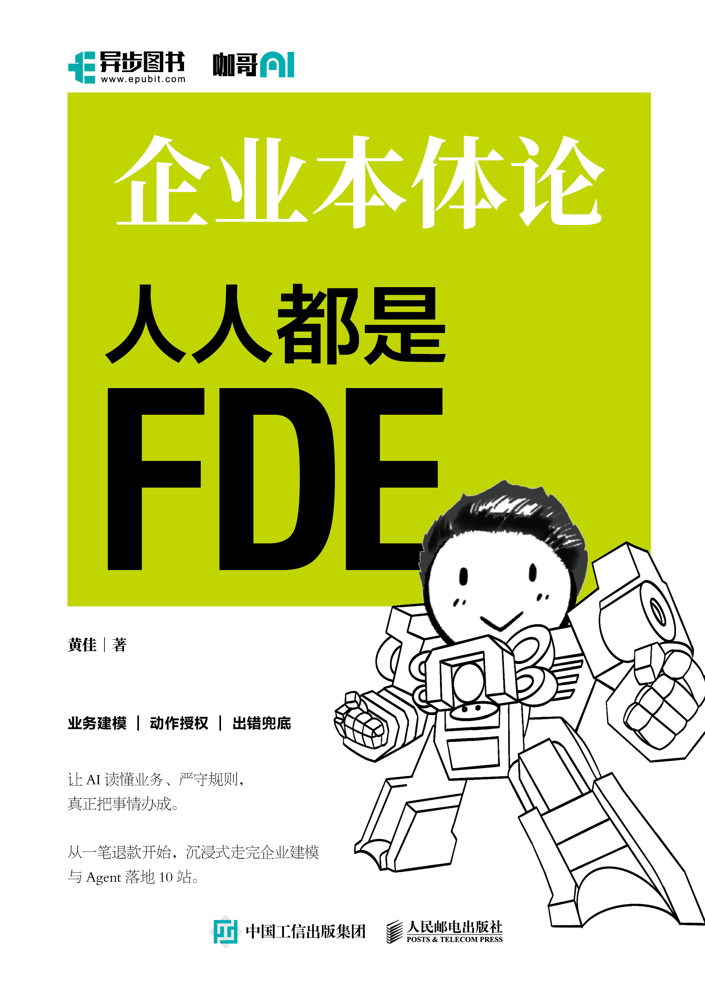

# 企业本体论：人人都是 FDE

<a href="https://u.jd.com/5gaL3hM"></a>

[京东购书：《企业本体论：人人都是FDE》](https://u.jd.com/5gaL3hM)

[快速启动](#快速启动) · [随书十站目录](docs/book-map.md) · [FDE 现场练习](docs/fde-playbook.md) · [版本记录](CHANGELOG.md)

## 我理解的 FDE

FDE，Forward-Deployed Engineer，通常译作前沿部署工程师。走进企业现场以后，你很快会发现，很多难题在技术之外。

客服说“已经退了”，财务可能只批准了申请，客户的钱还没有到账。两个系统都有“客户”这个字段，指的未必是同一个对象。工程师把接口接通了，异常工单却没有人接。模型再强，也不能替企业作出这些约定。

FDE 要把这些事情问明白，和业务人员、系统负责人一起作出选择，再把选择落实到程序和工作安排里。行业惯例、数据基础、部门分工都会影响方案。交付以后，组织还要有人维护规则、处理异常，必要时把工作收回。

“人人都是 FDE”是邀请大家参与这个过程。懂业务的人帮助我们找准问题，工程师把约束做成能执行的系统，管理者明确谁承担结果。没有谁仅凭一个人的知识，就能包办所有工作。

从简单场景开始。先跟完一笔业务，弄清一个对象，核实一项事实，限定一个动作。

## 快速启动

Python 3.11+，仅使用标准库。本地样例数据，离线运行。

```bash
git clone https://github.com/huangjia2019/ontology-fde.git
cd ontology-fde
python3 run.py serve --port 8000
```

访问 http://127.0.0.1:8000 。

## 业务事实与执行结果

工作台包含业务对象、退款处理、决策记录、测试与评估四个视图，默认申请为“遥控器单” `YF-R-0311`。


这笔申请金额为 347 元。ERP 查询返回 `not_found`，发票状态为 `unknown`，执行后转人工审核，不生成付款指令。业务经过见[遥控器单](docs/artifacts/01-field-walkthrough.md)。

Read 读取事实；Draft 生成建议和决策记录，两者均不修改业务对象。Write 执行规则允许的动作，可以直接调用，无需先运行 Read 或 Draft。

### 五笔退款申请

| 短名 | 申请编号 | 金额 | 执行结果 |
|---|---|---:|---|
| 遥控器单 | YF-R-0311 | 347 元 | 发票状态未知，转人工 |
| 刚好五百 | YF-R-0500 | 500 元 | 全部条件满足，批准并生成模拟付款指令 |
| 多出一分 | YF-R-0501 | 500.01 元 | 超过自动批准上限，转人工 |
| 小额黑名单 | YF-R-0312 | 199 元 | 风控条件不通过，转人工 |
| 合同优先 | YF-R-0415 | 480 元 | 企业合同客户，转人工核实合同 |

自动批准要求金额不超过 500 元，且其他条件全部满足。`approved` 表示申请已批准，付款指令 `created` 不代表资金到账。


## 一站一站的往下学

仓库包含十站完成后的参考实现。各站文档、命令与验收项见[随书目录](docs/book-map.md)。

| 站点 | 内容 |
|---|---|
| [1. 确定业务范围](docs/artifacts/01-ontology-positioning-card.md) | 业务目标、对象、来源与自动化范围 |
| [2. 审视原有方案](docs/artifacts/02-historical-audit.md) | 从辅助建议到执行操作的风险审计 |
| [3. 登记执行主体](docs/artifacts/03-identity-acceptance.md) | Agent 身份、归属与生命周期 |
| [4. 建立最小本体](docs/artifacts/04-minimum-ontology.md) | 对象、关系、状态与来源映射 |
| [5. 限定业务动作](docs/artifacts/05-action-contract.md) | 动作契约、幂等与补偿 |
| [6. 整理判断依据](docs/artifacts/06-rule-assets.md) | 规则来源、适用范围与草稿审核 |
| [7. 验证权限](docs/artifacts/07-identity-and-permissions.md) | 身份登记、授权配置与拒绝测试 |
| [8. 处理协作分歧](docs/artifacts/08-multi-agent-coordination.md) | 任务委托、冲突裁决与人工交接 |
| [9. 评估和复盘](docs/artifacts/09-evaluation-audit-and-incident-replay.md) | 决策记录、策略评估与事故回放 |
| [10. 交还组织](docs/artifacts/10-operations-handoff-and-replication.md) | 运行维护、移交与退出检查 |

检查指定站点的文件、字段及部分约束，不改变功能启用状态：

```bash
python3 run.py checkpoint 4 --check
```

协作冲突与故障补偿：

```bash
# 风控否决自动批准，转人工复核
python3 run.py run YF-R-0610 --mode write

# 模拟付款指令创建失败
python3 run.py run YF-R-0800 --mode write --simulate-payment-failure
```

付款指令创建失败后，申请进入 `approval_pending_payment`，生成财务处理任务。


## 命令行与源码

```bash
python3 run.py inspect YF-R-0311
python3 run.py run YF-R-0311 --mode draft
python3 run.py run YF-R-0500 --mode write --audit artifacts/my-first-decision.jsonl
```

CLI 每次调用重新加载样例。Web 状态保留在服务进程中，重置或重启后恢复初始数据。`--audit` 追加 JSONL 决策记录，不持久化业务状态。

| 模块 | 入口 |
|---|---|
| 跨系统对象与来源 | [repository.py](src/ontology_fde/repository.py) |
| 退款规则 | [policy.py](src/ontology_fde/policy.py) |
| 授权、执行、幂等与补偿 | [engine.py](src/ontology_fde/engine.py) |
| 决策记录 | [audit.py](src/ontology_fde/audit.py) |
| 对象与动作定义 | [本体配置](config/ontology/)与[动作契约](config/actions/) |
| 测试与评估 | [测试](tests/)与[评估样例](config/evals/) |

`.yaml` 配置使用 JSON 兼容格式。规则由配置与 Python 代码共同实现，见[架构说明](docs/architecture.md)。

## 测试与评估

```bash
python3 tools/verify.py
```

检查范围：文档与截图、单元及集成测试、36 个策略样例、2 个事故回放、十站检查卡及退出准备项。失败返回非零退出码。

出版基线为 53 项测试，仓库另有交付检查与新增回归测试。数量以运行结果为准，见[测试口径](docs/release-baseline.md)。


导出评估报告：

```bash
python3 run.py evaluate --output artifacts/evaluation-report.json
```

## 问题反馈

请在 [Issues](https://github.com/huangjia2019/ontology-fde/issues) 提供环境、复现命令及预期与实际结果，勿上传密钥或客户数据。
