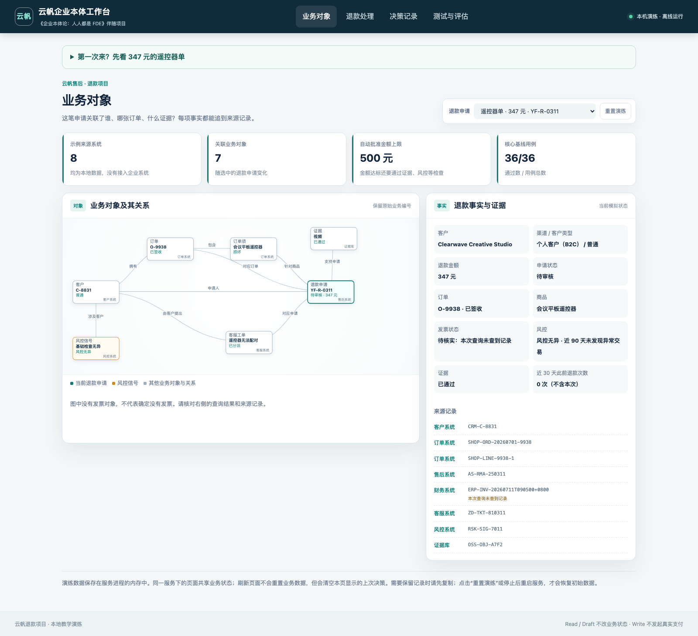
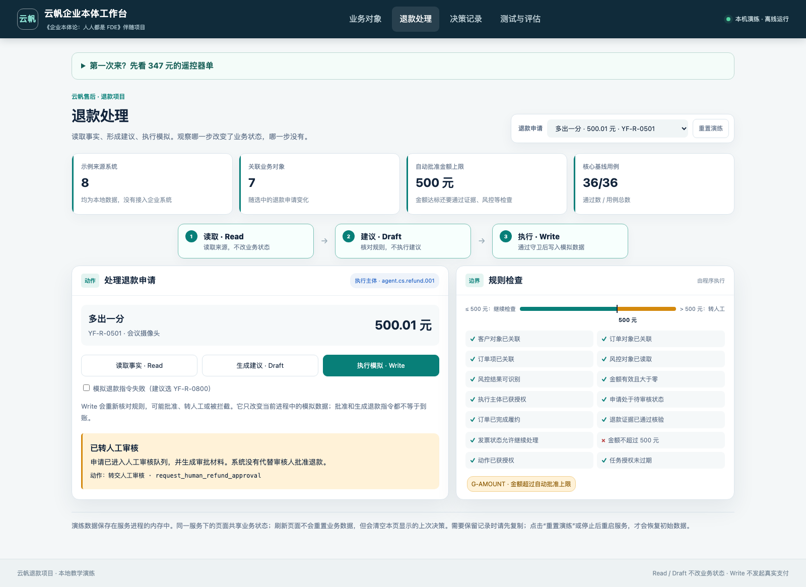
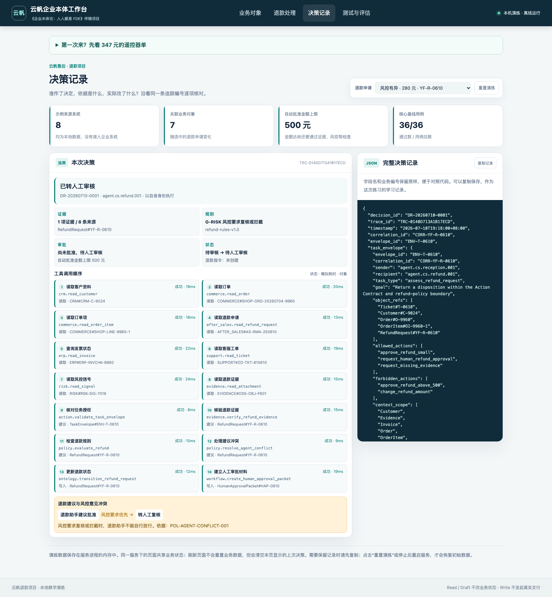
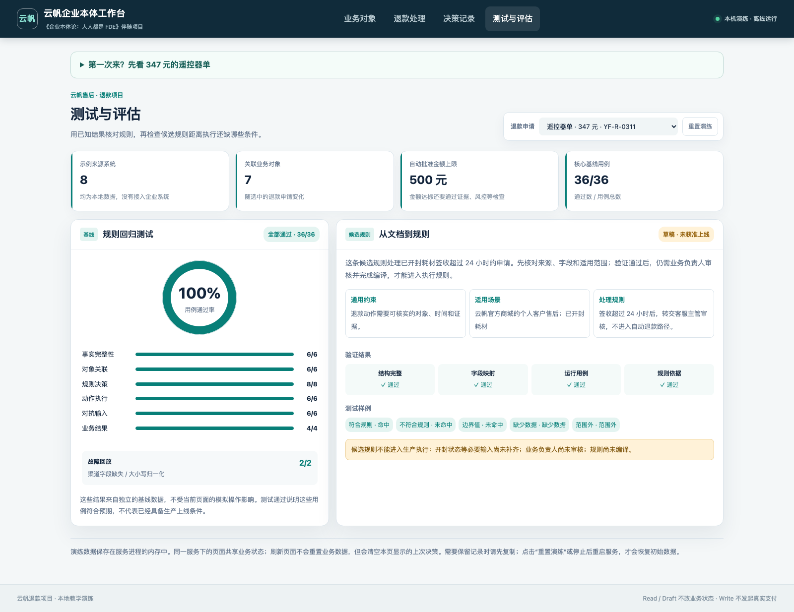

# 企业本体论：人人都是 FDE

你好，我是黄佳，大家也叫我咖哥。这里是《企业本体论：人人都是FDE》的配套项目。

书里，我们跟着云帆的一笔退款，逐步认识企业里的对象、事实、规则、权限和责任。在这里，你可以亲手检查这些判断：发票没有查到，能不能退款？金额只多了一分钱，处理方式为什么就变了？两个 Agent 意见不同，谁来决定下一步？

我希望你带走一些实践中的体感。看到程序停下来，知道它缺的是什么；看到程序执行成功，还会追问业务有没有做完、结果交给了谁。

[开始第一轮练习](#先把一笔业务走通) · [随书十站目录](docs/book-map.md) · [学习记录](docs/learning-log.md) · [FDE 现场练习](docs/fde-playbook.md) · [版本记录](CHANGELOG.md)

## 我理解的 FDE

FDE，Forward-Deployed Engineer，通常译作前沿部署工程师。走进企业现场以后，你很快会发现，很多难题在技术之外。

客服说“已经退了”，财务可能只批准了申请，客户的钱还没有到账。两个系统都有“客户”这个字段，指的未必是同一个对象。工程师把接口接通了，异常工单却没有人接。模型再强，也不能替企业作出这些约定。

FDE 要把这些事情问明白，和业务人员、系统负责人一起作出选择，再把选择落实到程序和工作安排里。行业惯例、数据基础、部门分工都会影响方案。交付以后，组织还要有人维护规则、处理异常，必要时把工作收回。

“人人都是 FDE”是邀请大家参与这个过程。懂业务的人帮助我们找准问题，工程师把约束做成能执行的系统，管理者明确谁承担结果。没有谁仅凭一个人的知识，就能包办所有工作。

起点可以很小。先跟完一笔业务，弄清一个对象，核实一项事实，限定一个动作。这个仓库就从这里开始。

## 先把一笔业务走通

不急着读源码，先看[“遥控器单”的业务经过](docs/artifacts/01-field-walkthrough.md)。这笔申请是 **347 元**，订单和签收都能核对，财务系统却只返回“本次未查到发票记录”。

请先判断：你会让 Agent 批准退款吗？如果不批，下一步该找谁？

### 1. 准备环境

需要 **Python 3.11 或更新版本**。运行项目不需要安装第三方 Python 包，也不需要大模型账号、API Key、Docker 或数据库。它在本机使用样例数据和确定性规则，不调用大模型，也不连接真实企业系统。

先在终端检查版本：

```bash
python3 --version
```

macOS 自带的 Python 可能较旧。可以从 [Python 官网](https://www.python.org/downloads/) 安装新版，再确认版本。Windows 可以用 `py -3 --version`；后面的 `python3` 都可替换成 `py -3`。如果你已有符合要求的 `python` 命令，直接用它也可以。

取得项目：

```bash
git clone https://github.com/huangjia2019/ontology-fde-practical-guide.git
cd ontology-fde-practical-guide
python3 run.py serve --port 8000
```

没有 Git，也可以在本页点击 **Code → Download ZIP**，解压后在项目目录打开终端，再执行最后一行。看到服务启动后，用浏览器打开 **http://127.0.0.1:8000**。结束练习时回到终端按 `Ctrl+C`。

### 2. 先看事实，再看建议

工作台默认选择“遥控器单”。四个页面依次展示业务对象、动作、审计记录和评估结果。



先在“业务对象”页找到发票状态。这里要分清两句话：

- **本次未查到记录**：这一次查询得到的结果。
- **确认没有发票**：需要财务依据支持的业务判断。

程序保存的查询结果是 `not_found`，发票状态是 `unknown`。它没有把“没查到”改写成“确定没有”。

进入“退款处理”，依次点 **读取事实 · Read**、**生成建议 · Draft**，观察事实和建议。随后点 **执行模拟 · Write**，这笔申请应转入人工处理，不生成付款指令。这里仍需要财务补充确认。

Read 不修改业务状态；Draft 形成建议和决策记录，也不批准退款。Write 才尝试执行允许的业务动作。你可以直接点击 Write，程序会重新读取事实、校验规则，不会沿用一份过期的页面建议。

### 3. 换一笔，先预测再执行

点击“重置演练”，换到下面的申请。每次先写下自己的判断，再点 Write 对照结果。

| 书中的短名 | 申请编号 | 金额 | 应当观察到什么 |
|---|---|---:|---|
| 遥控器单 | YF-R-0311 | 347 元 | 发票情况未知，转人工；不生成付款指令 |
| 刚好五百 | YF-R-0500 | 500 元 | 其他条件均满足，批准并生成模拟付款指令 |
| 多出一分 | YF-R-0501 | 500.01 元 | 超过自动批准上限，转人工 |
| 小额黑名单 | YF-R-0312 | 199 元 | 金额虽小，风控条件不通过，转人工 |
| 合同优先 | YF-R-0415 | 480 元 | 企业合同客户需要按合同核实，转人工 |

**批准、生成付款指令、钱已到账，是三个不同的结果。** 本项目演示前两步，不会向任何人付款。



500 元与 500.01 元这一对样例，其他条件都满足自动批准要求。比较它们，是为了观察金额边界；不要据此推导出“500 元以内都可以自动退”。

### 4. 留下你的学习记录

打开[学习记录模板](docs/learning-log.md)，给自己留一条记录：

> 我原来认为：347 元，金额小，可以批准。
>
> 运行后发现：财务没有确认发票情况，程序转人工。
>
> 改变我判断的依据：查询没有结果，不足以证明发票不存在。
>
> 回到自己的企业要问：哪个岗位能确认？确认结果记在哪里？无人接手时怎么办？

模板还安排了“只改一个条件”的练习，帮助你区分读懂结果与理解规则。个人笔记可以放在本地 `learning-notes/`，运行输出放在 `artifacts/`；这两个目录的内容不会被默认加入 Git。请勿把客户数据、凭证或内部文件上传到公开仓库。

## 跟着书，逐站学下去

仓库提供的是**十站完成后的参考系统**。下面的检查会核对文件、字段和部分约束，不会逐站安装功能。各站还有对应的业务练习和测试，详见[完整学习目录](docs/book-map.md)。

| 站点 | 这一站练什么 |
|---|---|
| [1. 确定业务范围](docs/artifacts/01-ontology-positioning-card.md) | 跟完一笔退款，说清做什么、暂时不做什么 |
| [2. 审视原有方案](docs/artifacts/02-historical-audit.md) | 找出从“给建议”变成“能执行”后新增的责任 |
| [3. 登记执行主体](docs/artifacts/03-identity-acceptance.md) | 说明谁在执行、归谁负责、如何退出 |
| [4. 建立最小本体](docs/artifacts/04-minimum-ontology.md) | 把分散记录连成有来源、关系和状态的业务对象 |
| [5. 限定业务动作](docs/artifacts/05-action-contract.md) | 检查前提、权限、重试和执行失败 |
| [6. 整理判断依据](docs/artifacts/06-rule-assets.md) | 把制度与经验整理成有适用范围的规则草稿 |
| [7. 验证权限](docs/artifacts/07-identity-and-permissions.md) | 即使业务条件满足，也要检查执行者是否获准 |
| [8. 处理协作分歧](docs/artifacts/08-multi-agent-coordination.md) | 保存两个 Agent 的意见，按约定裁决和转交 |
| [9. 评估和复盘](docs/artifacts/09-evaluation-audit-and-incident-replay.md) | 追溯一次决定，把失败留下来做回归测试 |
| [10. 交还组织](docs/artifacts/10-operations-handoff-and-replication.md) | 确认谁维护、谁接手，以及怎样停止自动执行 |

例如，读到第 4 站时：

```bash
python3 run.py checkpoint 4 --check
```

读到第 8、9 站，可以再试两笔业务：

```bash
# 退款助手建议批准，风控要求复核：保留分歧，转人工
python3 run.py run YF-R-0610 --mode write

# 已批准，但创建付款指令失败：保存失败，交财务处理
python3 run.py run YF-R-0800 --mode write --simulate-payment-failure
```

第二个练习中，申请会进入 `approval_pending_payment`。它没有被假装恢复成“什么都没发生”，也没有被记成“退款完成”。



## 看过结果以后，再走进代码

如果你希望从终端观察同一笔申请：

```bash
python3 run.py inspect YF-R-0311
python3 run.py run YF-R-0311 --mode draft
python3 run.py run YF-R-0500 --mode write --audit artifacts/my-first-decision.jsonl
```

最后一条命令将决策记录保存到本地文件。**每次 CLI 命令都启动一个新进程，重新载入初始数据**；上一条命令的业务状态不会带到下一条。浏览器工作台则在同一个服务进程内保留状态，刷新页面不等于重置。重置或重启服务会恢复样例；想保留观察结果，请先复制审计记录。

| 想弄清的问题 | 从这里读起 |
|---|---|
| 一笔业务怎样从多个系统拼起来？ | [repository.py](src/ontology_fde/repository.py) |
| 为什么补证据、转人工或批准？ | [policy.py](src/ontology_fde/policy.py) |
| 谁能执行，重复执行或失败怎么办？ | [engine.py](src/ontology_fde/engine.py) |
| 判断依据如何保存？ | [audit.py](src/ontology_fde/audit.py) |
| 对象、状态和动作在哪里定义？ | [本体配置](config/ontology/)与[动作契约](config/actions/) |
| 怎样证明一次修改没有破坏已有行为？ | [测试](tests/)与[评估样例](config/evals/) |

配置中后缀为 `.yaml` 的文件采用 JSON 兼容写法，标准库即可读取。修改规则文字不会自动生成新的执行程序；哪些条件由配置控制、哪些仍由代码实现，见[架构与实现范围](docs/architecture.md)。

## 验证你的改动

完成第一轮练习后，运行：

```bash
python3 tools/verify.py
```

它会检查文档和截图、运行全部自动化测试，再检查 **36 个策略样例、2 个事故回放、十站检查卡及退出准备项**。全部通过时打印“全部离线检查通过”；任何一步失败都会返回非零退出码。

书中记录了出版基线的 53 项测试；仓库另有交付检查，并持续补充回归测试。当前数量以运行结果为准，[测试口径说明](docs/release-baseline.md)保留了这几者的区别。



也可以单独保存评估结果：

```bash
python3 run.py evaluate --output artifacts/evaluation-report.json
```

策略样例通过，说明这些预设判断符合预期。真实企业里的字段含义、数据质量、系统故障和人的接手情况，还需要到现场验证。更多练习见[FDE 现场练习](docs/fde-playbook.md)。

## 项目能做到哪里

这是本地教学实现。八组来源数据均为合成样例，不来自客户生产系统；`RefundAgent`、`RiskAgent` 在这里代表确定性角色与策略，没有接入语言模型。先把可检查的业务约束做出来，再讨论如何连接模型，是这个练习的安排。

- 身份登记与权限配置用来演示约束，不是企业 IAM 或真实登录认证。
- 重复执行保护和业务状态存放在内存中，没有跨进程持久化保障。
- 时间及耗时包含样例设定，不能拿页面数字当作生产性能测试。
- 退出检查核对配置和交接材料，不会真的撤销企业凭证或派发生产工单。
- 真实落地仍需补齐持久化、身份认证、数据保护、支付及审批集成，并由相应业务负责人确认。

请勿用它处理真实退款。源码采用 [MIT 许可证](LICENSE)，可以学习、修改和复用；复用到企业之前，请重新核实每一个业务假设。

## 遇到问题

- **提示 Python 版本过低**：先运行 `python3 --version`，换用 3.11 或更新版本。不要只改版本检查。
- **找不到 run.py**：终端还没进入项目根目录。目录里应当能看到本页和 `run.py`。
- **8000 端口被占用**：改用 `python3 run.py serve --port 8001`，浏览器也改成 8001。
- **重新运行后状态恢复了**：CLI 每次独立启动；浏览器重置或服务重启也会恢复初始样例。
- **页面加载不全**：保持服务终端运行，用浏览器访问本机地址，不要直接双击 HTML 文件。
- **测试或预期结果不一致**：请在 [Issues](https://github.com/huangjia2019/ontology-fde-practical-guide/issues) 附上操作系统、Python 版本、执行命令、预期和实际结果。删除个人信息、密钥和客户材料后再提交。

一笔业务走通以后，可以把书合上，试着向一位业务同事解释：这次为什么能做、为什么要停、接下来需要谁。能讲清楚这些，我们就有了继续走进企业现场的基础。
