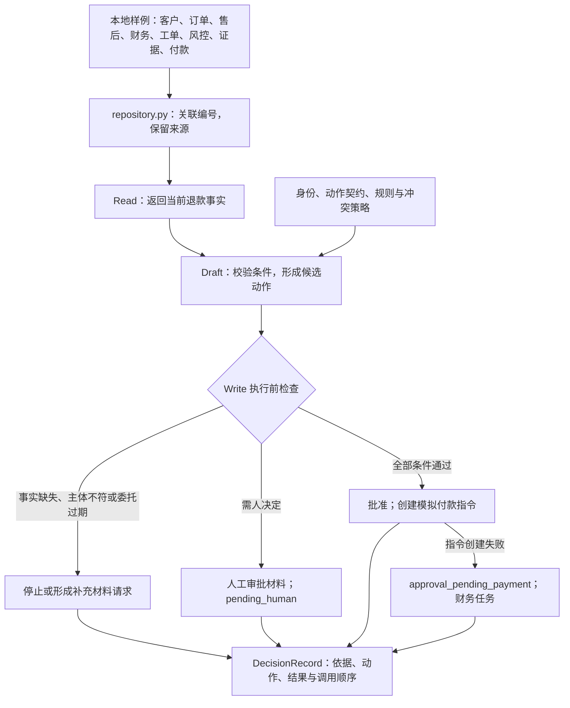

# 云帆退款助手：事实怎样进入一次受控动作

客服收到一笔 347 元的退款申请。程序能找到客户、订单、商品、工单、风控和视频证据，但 ERP 查询没有返回发票记录。这项未知事实会阻止自动批准。下面的结构图说明判断经过哪些环节。

这是离线参考实现：没有大模型调用，没有远程 CRM、ERP 或支付接口。样例数据读入内存，规则和动作由 Python 程序执行。图中的系统名表示样例的来源角色。

## 本体解决哪些问题

本项目只建模退款所需的业务范围：谁申请、退哪个商品、依据来自哪里、允许怎样改变状态、失败后留下什么待办。

| 资产 | 文件 | 在退款中的作用 |
|---|---|---|
| 对象目录 | [objects.yaml](../config/ontology/objects.yaml) | 六种核心对象及发票、证据、付款指令三种辅助对象 |
| 关系定义 | [relationships.yaml](../config/ontology/relationships.yaml) | 规定客户、订单、申请、证据等对象怎样关联 |
| 状态机 | [state_machines.yaml](../config/ontology/state_machines.yaml) | 规定退款状态转换，包括付款指令失败后的补偿状态 |
| 术语表 | [glossary.yaml](../config/ontology/glossary.yaml) | 区分退款申请、批准、补偿、付款指令等业务含义 |
| 来源映射 | [source_map.yaml](../config/ontology/source_map.yaml) | 将业务字段指向来源，并记录新鲜度要求 |

`EnterpriseRepository.get_case()` 按编号和外键关联样例记录；`graph()` 再从这些记录生成节点与边。关系类型是人定义的，当前有哪些对象及连线由数据决定。新增付款指令后，图上才会出现对应的付款对象。ERP 查无记录时，不会凭空生成一张“无发票”。

来源映射中的新鲜度 SLA 是设计要求。本地程序没有持续刷新各来源，也没有实现所有字段的超时拦截。接入企业系统时，需要补上实际观测时间、刷新机制和过期处理。

## Read、Draft、Write 分别会发生什么

| 模式 | 返回内容 | 业务状态与副作用 |
|---|---|---|
| `read` | 关联后的事实与来源 | 不改变业务对象 |
| `draft` | 候选动作、规则命中、检查结果和决策记录 | 不批准退款，不创建付款指令；可以保存决策记录 |
| `write` | 执行结果与决策记录 | 经检查后，在内存中创建待办、推进状态或创建模拟付款指令 |

`write` 内部会经过事实读取与判断，读者无需先运行两个命令为它“解锁”。`YF-R-0500` 在其他条件通过时可以批准；`YF-R-0501` 的 500.01 元会转人工。金额上限只是其中一项条件，发票、证据、渠道、履约和风控也必须通过。

主要入口是 [engine.py](../src/ontology_fde/engine.py)。审批成功后的退款状态为 `approved`；付款指令状态为 `created`，尚未表示到账。创建指令失败会保留失败记录，将退款转入 `approval_pending_payment`，并生成财务任务。

## 规则配置与 Python 程序的分工

[policy.py](../src/ontology_fde/policy.py)读取金额上限、契约允许的主体、策略编号和冲突优先级；退款专用的条件判断写在 `evaluate()` 中。`.yaml` 文件使用 JSON 子集，便于标准库直接读取。

这里没有通用的自然语言规则解释器。把规则文本中的“24 小时”改成“48 小时”，不会自动重写 Python 条件。规则变更需要同时检查配置、实现、边界样例与回归结果。

[规则草稿演示](artifacts/06-rule-assets.md)采用固定样例、模板和确定性提取逻辑。它展示来源、校验、审核与编译门槛，不调用语言模型，也不会把新草稿自动装进当前退款策略。

## 多 Agent 协作如何呈现

`YF-R-0610` 的金额为 280 元。退款条件允许提出批准建议，风控信号却要求复核。当前实现按[冲突策略](../config/policies/conflict_resolution.yaml)选择 `RiskAgent:review`，保留两个候选意见，并创建人工审批材料。

程序使用登记的角色、任务信封和确定性裁决来呈现协作，没有启动三个独立大模型进程。任务信封记录对象范围、收件人、允许动作和到期时间；执行器会拒绝主体不匹配或过期的写入。

## 本地状态、时间与审计

每次单独运行 CLI，都会重新加载样例。业务状态和幂等表留在本次进程内；连续运行两条相同 CLI 命令，会各自开始一次新实验。同一引擎实例中的重复业务意图由测试验证；浏览器工作台在服务进程存活期间保留其内存状态。

`--audit` 指定的 JSONL 文件按行追加决策记录；它是实验留档，不会让业务状态跨进程恢复，也不具备防篡改保证。使用不同文件名可以保留不同轮次的实验。

默认处理时间采用样例申请时间，以便复现。`--processing-at` 可指定带时区的时间来测试任务过期。调用轨迹中的 `duration_ms` 为可复现的模拟耗时，不能作为真实接口或模型性能数据。

## 接入企业系统前还缺什么

| 当前实现 | 企业项目需要落实的工作 |
|---|---|
| 本地 JSON 与编号映射 | 经授权的只读连接器，字段责任、新鲜度与脱敏 |
| 内存对象与幂等表 | 业务 API、持久化幂等、并发控制、事务与对账 |
| `agent_id` 字符串与权限配置 | 工作负载身份验证、凭据管理、字段权限、授权期限和环境隔离 |
| 模拟人工审批材料 | 实际审批队列、接收人、超时升级与处理回执 |
| JSONL 决策记录 | 企业审计保存、访问控制、防篡改与检索 |
| 离线退出检查 | 各系统实际停用写入、撤销凭据、迁移待办与验证业务连续性 |

权限文件声明了六个维度，当前代码没有把全部声明实现成安全基础设施。详见[权限验收卡](artifacts/07-identity-and-permissions.md)。参考程序的价值在于让这些问题有可读、可运行的讨论对象；生产验收还需要业务、技术和安全团队共同完成。

继续阅读：[十站目录](book-map.md) · [架构图源文件](assets/architecture/yunfan-ontology-agent-system-evolution.mmd) · [测试口径](release-baseline.md)
